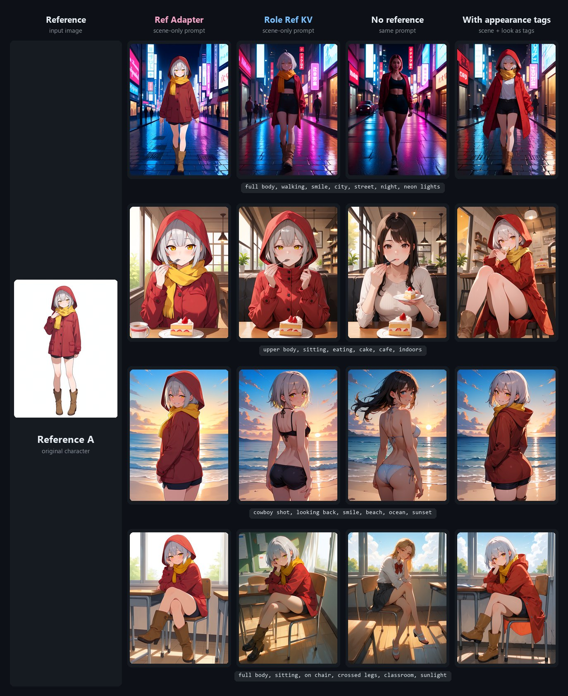
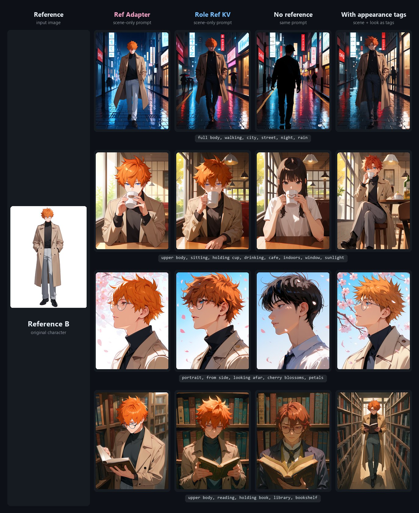

# 🧬 Anima Reference for Forge Neo

<div align="center">

[](https://github.com/Haoming02/sd-webui-forge-classic/tree/neo)
[](https://gradio.app/)
[](https://github.com/eduardoabreu81/anima-reference-forge-neo)
[](LICENSE)

> **Extension for [Stable Diffusion WebUI Forge - Neo](https://github.com/Haoming02/sd-webui-forge-classic/tree/neo)**

</div>

Give **[Anima](https://huggingface.co/circlestone-labs/Anima)** one picture of a character and a prompt that only describes the scene: **who** is drawn - hair, eyes, outfit, accessories - comes from the picture, while **pose, place and framing** follow the prompt. No character name, artist tag or appearance tags needed, so it works for your original characters too.

Two community methods in one panel, each with its authors' own weights and math: ElectronGirl's **[Ref Adapter](https://github.com/ElectronGirl/ComfyUI-Anima-Ref-Adapter)** and AnticPan's **[Role Ref KV](https://huggingface.co/AnticPan/Anima-Role-Ref-KV)**.

> [!Important]
> This extension requires an up-to-date **Forge Neo** (the `neo` branch). On an older version it stays disabled and tells you so in the console - Forge Neo itself keeps working as usual.

---

## 📋 Table of Contents

- [What's New](#-whats-new)
- [Examples](#%EF%B8%8F-examples)
- [Features](#-features)
- [Installation](#-installation)
- [How to Use](#%EF%B8%8F-how-to-use)
- [Recommended Settings](#%EF%B8%8F-recommended-settings)
- [Tips](#-tips)
- [Limitations](#%EF%B8%8F-limitations)
- [API](#-api)
- [Credits](#-credits)

---

## 🆕 What's New

### v0.1.0 - First Release

- **Your character in any scene** - an **Anima Reference** panel in txt2img and img2img: drop a picture, write the scene, generate
- **Two methods** - ElectronGirl's **Ref Adapter**, with its own reference guidance, and AnticPan's **Role Ref KV**
- **Turbo checkpoints and Hires. fix** - 8 steps at CFG 1 work, and the second pass reads the reference at its own size

---

## 🖼️ Examples

Each row is one scene, with the same seed in every column. **Ref Adapter** and **Role Ref KV** got only the scene, as did **No reference**; **With appearance tags** is what Anima draws when the prompt also describes the character with tags - the usual way without this extension.

<p align="center"></p>

<p align="center"></p>

In these runs both methods kept the face, hair, eyes and colors in every scene. **Ref Adapter** held on to the whole outfit - the hood stays up and the raincoat stays on even at the beach - while **Role Ref KV** let the scene change the clothes more. Small accessories such as the glasses come and go with both.

Every picture: an Anima turbo checkpoint (`anima_aesthetic_turbo_v11`), Euler, Simple, 8 steps, CFG 1, 768x1024, adapter strength 1, prompt `masterpiece, best quality, score_7, newest, highres, absurdres, safe, <gender>, solo, <scene>`, on an RTX 2070. Seeds were not cherry-picked. Both references are original characters made with the same checkpoint.

---

## 🎯 Features

### 🧬 Ref Adapter

- By **[ElectronGirl](https://github.com/ElectronGirl/ComfyUI-Anima-Ref-Adapter)** - see the authors' **[technical report](https://github.com/ElectronGirl/ComfyUI-Anima-Ref-Adapter/blob/main/docs/report.md)** for the method, data and failure modes
- The reference is fitted into the picture's size and becomes a **second picture next to the one being drawn**, clean at every step, placed one picture height away so the model reads it without copying its pose
- A small LoRA (92 MB), on only while the reference is there, teaches the model to read it
- **Reference guidance** on top of your CFG Scale: higher values bring more of the character's details and style, with **APG** or **CFG rescale** to keep colors in check

### 🔑 Role Ref KV

- By **[AnticPan](https://huggingface.co/AnticPan/Anima-Role-Ref-KV)**
- The reference goes through the model **once per generation**, at its own size; every step of the picture then looks at what the model saw there
- Your usual CFG: the prompt pass sees the reference, the negative pass does not
- A larger LoRA (529 MB), run in FP32 as in the authors' code

### ⚡ Turbo Checkpoints

- Both methods work with Anima turbo checkpoints at their usual **8 steps and CFG 1** - about 35 s per 768x1024 picture on an RTX 2070, the same as without a reference
- **Hires. fix** works with both: the second pass reads the reference again at its own size

### 🎛️ Familiar Forge Controls

- Runs inside txt2img and img2img - no separate tab, no node graph
- Your checkpoint, LoRAs, sampler, CFG and Hires. fix as usual; post-CFG extensions still run after it
- Finds each method's weights in your LoRA folder by itself, from the files' own metadata
- Settings go into the infotext and come back with **PNG Info → Send to txt2img**

### 🛡️ Safe by Design

- Changes no Forge Neo file - remove the extension and everything is as it was
- Checks your Forge Neo at startup and stays disabled if something it needs is missing
- The methods' LoRAs are on only while the panel is in use - they never leak into other generations
- Other models are not affected

---

## 📦 Installation

1. Open Forge Neo WebUI
2. Go to **Extensions** → **Install from URL**
3. Paste: `https://github.com/eduardoabreu81/anima-reference-forge-neo`
4. Click **Install** and restart the WebUI
5. Download the weights of the method you want into `models/Lora` (any subfolder works):

| Method | File | Size |
| :--- | :--- | :--- |
| Ref Adapter | [`anima_ref_adapter_pilot_r32.safetensors`](https://huggingface.co/ElectronGirl/anima-ref-adapter/blob/main/anima_ref_adapter_pilot_r32.safetensors) | 92 MB |
| Role Ref KV | [`comfy/anima-role-ref-kv-v1.0.safetensors`](https://huggingface.co/AnticPan/Anima-Role-Ref-KV/blob/main/comfy/anima-role-ref-kv-v1.0.safetensors) - the file in the `comfy` folder | 529 MB |

6. You also need an Anima checkpoint, the Qwen3-0.6B text encoder and the Qwen-Image VAE from [circlestone-labs/Anima](https://huggingface.co/circlestone-labs/Anima), set up as for any Anima generation

> [!Note]
> Do **not** add these files to the prompt as `<lora:...>` - that would apply them without the reference. The panel loads them on its own.

---

## 🖱️ How to Use

1. Pick an Anima checkpoint
2. Open **Anima Reference**, tick it, choose the **Method** and drop the reference picture in
3. Write the scene: quality tags, gender, `solo`, then the pose, place and framing - for example `masterpiece, best quality, score_7, newest, highres, absurdres, safe, 1girl, solo, upper body, sitting, eating, cake, cafe, indoors`
4. Generate

| Control | What it does |
| :--- | :--- |
| **Method** | Ref Adapter or Role Ref KV; the weights list and the controls below follow it |
| **Adapter weights** | the method's file, found in the LoRA folders (🔄 looks again) |
| **Adapter strength** | the method's LoRA weight; 1 is what it was trained at |
| **Reference guidance** | Ref Adapter only. 1 = the reference in both CFG passes (faster); higher = more of the character's details and style, and more saturation. Needs CFG above 1 |
| **Correction** | Ref Adapter only. `apg` keeps colors under control at high reference guidance; `rescale` (with **Rescale phi**) is the alternative |
| **Advanced** | Ref Adapter only. Where the reference sits next to the picture (keep 1.0, the training value) and the grey of the letterbox around it (255, white, as in training) |

---

## ⚙️ Recommended Settings

The authors' settings, on Anima base v1.0:

| Method | Sampler | Schedule type | Steps | CFG | Size | Other |
| :--- | :--- | :--- | :--- | :--- | :--- | :--- |
| Ref Adapter | Euler | Simple | 28-30 | 4.5 | 896x1152 | Reference guidance 4.5-6, Correction apg |
| Role Ref KV | Euler | Simple | 28 | 4 | about 1 MP: 832x1216, 1024x1024, 1216x832 | BF16 |

With a turbo checkpoint, keep its own steps and CFG (8 and 1 in the examples above).

---

## 💡 Tips

- Use a clear picture of one character, unobstructed - a full-body picture on a plain background works best
- Describe only the scene: the pose, the place, the framing, the expression. Appearance tags fight the reference
- At CFG 1, Forge Neo skips the negative prompt, and Ref Adapter's reference guidance is built from it: the extension runs it as 1, says so in the console and writes `Anima Ref guidance: 1.0` in the infotext. For more of the reference on a turbo checkpoint, raise CFG a little (1.5 worked) and reference guidance with it
- Ref Adapter at reference guidance above 1 runs three model passes per step instead of two; at 1 it costs about the same as a plain generation
- Role Ref KV's weights take 529 MB of video memory on top of the model while it runs

---

## ⚠️ Limitations

From the authors:

- **Ref Adapter** (pilot release: 300 training characters): identity transfers much better than style; small patterns, scars, earrings and unusual skin tones are often lost; large garments can drift in color; the reference character occasionally reappears as an object in the scene
- **Role Ref KV**: details may drift with difficult references or strong prompt changes; other base models, quantized weights and additional LoRAs were not validated; NSFW content was filtered out of its training data
- Both were trained on Anima base v1.0 and inherit its biases

In Forge Neo:

- Forge's own **Anima reference** setting (for the edit LoRA) is ignored while the panel runs
- Batches use the same reference for every picture
- Role Ref KV was released for BF16 or FP32; on FP16 cards such as the RTX 20 series small differences from the authors' pictures are expected

---

## 🧭 API

```python
"alwayson_scripts": {
    "anima reference": {
        "args": [True, "Ref Adapter", "<reference image as base64>", "anima_ref_adapter_pilot_r32.safetensors",
                 1.0, 4.5, "apg", 0.5, 1.0, 255]
    }
}
```

Arguments, in order: enable, method (`Ref Adapter` or `Role Ref KV`), image, weights (as listed in the panel, with its subfolder), strength, reference guidance, correction, rescale phi, RoPE offset, letterbox fill. The last five only apply to Ref Adapter.

---

## 📄 Credits

- **[Forge Neo](https://github.com/Haoming02/sd-webui-forge-classic/tree/neo)** by Haoming02
- **[Anima](https://huggingface.co/circlestone-labs/Anima)** by CircleStone Labs
- **[ElectronGirl](https://github.com/ElectronGirl)** - the Anima Reference Adapter, its weights, report and [ComfyUI nodes](https://github.com/ElectronGirl/ComfyUI-Anima-Ref-Adapter)
- **[AnticPan](https://huggingface.co/AnticPan)** - [Anima Role Ref KV](https://huggingface.co/AnticPan/Anima-Role-Ref-KV), its weights and reference code

The weights of both methods are derivatives of the CircleStone Model, released by their authors under the CircleStone Non-Commercial License ([Ref Adapter](https://huggingface.co/ElectronGirl/anima-ref-adapter/blob/main/LICENSE.md), [Role Ref KV](https://huggingface.co/AnticPan/Anima-Role-Ref-KV/blob/main/LICENSE-MODEL.txt)); this extension does not include them. Not affiliated with or endorsed by CircleStone Labs or the methods' authors.

---

## 📜 License

AGPL-3.0 - see [LICENSE](LICENSE). The code ported from the methods keeps its Apache-2.0 notices - see [NOTICE](NOTICE) and [LICENSE-APACHE](LICENSE-APACHE).

---

<div align="center">

Made with ❤️ for the Stable Diffusion community

**[Report Bug](https://github.com/eduardoabreu81/anima-reference-forge-neo/issues)** • **[Request Feature](https://github.com/eduardoabreu81/anima-reference-forge-neo/issues)** • **[☕ Ko-fi](https://ko-fi.com/eduardoabreu81)**

</div>
